# AegisVM (`aegis-cli`): Unified Rust Opcode Verifier & Behavioral MicroVM Sandbox

[](LICENSE)
[](https://www.rust-lang.org)
[](https://github.com)

**AegisVM** is a high-performance, zero-trust binary verification and behavioral sandboxing CLI tool written in **Rust**. It unifies static opcode analysis, hardware-virtualized RAM opcode introspection, and OS-level behavioral sandboxing into a single command-line workflow supporting both **x86_64** and **ARM64 (AArch64 / Apple Silicon)** binaries.

AegisVM runs cross-platform on **Linux**, **macOS** (Apple Silicon & Intel), and **Windows**.

---

## 1. Unified Architecture & CLI Execution Flowchart

```mermaid
flowchart TD
    CLI(["💻 CLI Invocation: aegis-cli <SUBCOMMAND> [FLAGS] <BINARY>"]) --> ArgParse["clap::Parser::parse()<br/>Load Policy TOML/JSON + Select Subcommand:<br/>verify | static-audit | detonate | diff-ram | policy"]
    ArgParse --> Parse["goblin::Object::parse(bytes)<br/>Extract ELF / PE / Mach-O (Universal Fat Binary)<br/>Auto-Detect or Override TargetArch::X86_64 / AArch64"]

    %% STAGE 1: STATIC OPCODE VERIFICATION
    subgraph Stage1 ["Stage 1: Multi-Arch Static Opcode & Control-Flow Gatekeeper"]
        Parse --> EntropyCheck{"Section Entropy > 7.2<br/>or Missing .text?"}
        EntropyCheck -- "Yes (Packed/Encrypted)" --> FlagPacked["Tag Binary: Metadata::Packed<br/>Enable Strict Unpacking & Cache Trap in Sandbox"]
        EntropyCheck -- "No" --> ArchSelect{"Match TargetArch"}
        FlagPacked --> ArchSelect

        ArchSelect -- "X86_64" --> DisasmX86["iced_x86::Decoder<br/>Variable-Length (1-15 Byte) Stream"]
        ArchSelect -- "AArch64 (ARM64)" --> DisasmArm["bad64 & Native A64 Decoder<br/>Fixed 32-Bit (4-Byte Aligned) Stream"]

        DisasmX86 --> StaticScan["Audit Opcodes & Build CFG (petgraph::DiGraph)<br/>• x86: Flag SYSCALL / INT 0x80 / RDTSC / CPUID<br/>• ARM64: Flag SVC #0 / HVC / SMC / MRS CNTVCT_EL0 / BRK<br/>• Verify PAC (PACIASP/AUTIASP) & BTI Landing Pads"]
        DisasmArm --> StaticScan
        
        StaticScan --> StaticVerdict{"Result<StaticBaseline, SecurityViolation>"}
        StaticVerdict -- "Err(Violation)" --> AbortStatic(["🛑 EXIT CODE 10: STATIC VIOLATION<br/>Zero Execution Cycles Granted"])
    end

    %% STAGE 2: INTEGRATED SANDBOX & MICROVM ENVIRONMENT
    subgraph Stage2 ["Stage 2: Integrated Rust MicroVM & Behavioral Sandbox Environment"]
        StaticVerdict -- "Ok(StaticBaseline)" --> ModeCheck{"CLI Subcommand ==<br/>static-audit only?"}
        ModeCheck -- "Yes" --> CommitStatic(["✅ EXIT CODE 0: STATIC AUDIT PASSED"])
        ModeCheck -- "No (verify / detonate)" --> ProvisionSandbox["SandboxOrchestrator::provision()<br/>1. Allocate Guest RAM with W^X EPT / Stage-2 MMU<br/>2. Mount Ephemeral Copy-on-Write (CoW) OverlayFS & Canary Honeypots<br/>3. Attach Virtual TAP NIC -> Local INetSim Sinkhole & PCAP Recorder"]
        ProvisionSandbox --> Hardening["Anti-Evasion & Hardware Spoofing<br/>• Spoof SMBIOS / MAC / Disk Serials / CPUID / MIDR_EL1<br/>• Hook Virtual Clock for Time-Bomb Fast-Forwarding<br/>• Enable ARM64 Cache Flush Traps (IC IVAU)"]
    end

    %% STAGE 3: RUNTIME LOOP (RAM OPCODES + BEHAVIORAL TELEMETRY)
    subgraph Stage3 ["Stage 3: Unified Runtime Loop (RAM Opcode Verification + Behavioral Analysis)"]
        Hardening --> VcpuLoop["sandbox.detonate_and_monitor() -> Poll vCPU Exits & Telemetry"]

        %% 3 Parallel Runtime Interception Channels
        VcpuLoop --> RamTrap["1. Hypervisor Memory / Cache Trap:<br/>• x86: EptViolation (Execute on Writable Page)<br/>• ARM64: Stage2InstructionAbort (ESR_EL2)<br/>• ARM64: Trapped Cache Flush (DC CVAU / IC IVAU)"]
        VcpuLoop --> EvasionTrap["2. Anti-Sandbox / Stalling Trap:<br/>• CPUID / RDTSC / MRS CNTVCT_EL0<br/>• nanosleep / clock_nanosleep Syscall"]
        VcpuLoop --> SandboxTelemetry["3. Behavioral Sandbox Sensors:<br/>• File System CoW Writes & Canary Access<br/>• Process Tree (fork / execve / ptrace / memfd_create)<br/>• Virtual NIC Packet Stream (DNS / TLS / C2)"]

        %% Branch 1: Dynamic RAM Opcode Verification
        RamTrap --> RamDiff["RamOpcodeVerifier::audit_guest_page(gpa_or_ipa)<br/>• Read Live Guest RAM Page (4KB x86 / 16KB Apple Silicon)<br/>• Diff Live .text Opcodes against Stage-1 StaticBaseline<br/>• Disassemble Unbacked Pages (iced_x86 / bad64)"]
        RamDiff --> RamVerdict{"Inline Hook (JMP / LDR+BR),<br/>ROP/PAC Violation,<br/>or Unpacked Shellcode?"}

        %% Branch 2: Anti-Evasion Countermeasures
        EvasionTrap --> SpoofAndAccel["• Return Spoofed Bare-Metal CPU IDs<br/>• Fast-Forward Virtual Clock (+3600s in <1ms) to Trigger Time-Bombs"]
        SpoofAndAccel --> VcpuLoop

        %% Branch 3: Behavioral Scoring Engine
        SandboxTelemetry --> BehaviorEngine["SandboxBehavioralEngine::evaluate_event()<br/>• Ransomware Check: High-Frequency Write + Shannon Entropy > 7.4?<br/>• Canary Tripwire: Read/Modify ~/.ssh/id_rsa or /etc/shadow?<br/>• Process Injection: ptrace(PTRACE_POKETEXT) or memfd_create exec?<br/>• Network C2: Unauthorized Outbound IP / Raw Socket / DNS Tunneling?"]
        BehaviorEngine --> BehaviorVerdict{"Risk Score >= Threshold<br/>or Critical Rule Hit?"}
    end

    %% VERDICTS & TERMINATION
    RamVerdict -- "Yes -> Err(RamViolation)" --> KillSandbox(["🚨 EXIT CODE 20/30: RUNTIME VIOLATION<br/>Export Forensic Bundle (RAM Dump + CoW Diff + PCAP + JSON Report)"])
    BehaviorVerdict -- "Yes -> Err(BehaviorViolation)" --> KillSandbox

    RamVerdict -- "No" --> GrantExec["Lock Page to Read+Execute (Clear Write Bit)<br/>Resume vCPU"]
    BehaviorVerdict -- "No" --> GrantExec
    GrantExec --> ExecutionDone{"Guest Process Exited<br/>or Execution Done?"}
    ExecutionDone -- "No (Continue)" --> VcpuLoop
    ExecutionDone -- "Yes (Clean Exit & 0 Violations)" --> Commit(["✅ EXIT CODE 0: VERIFIED SAFE<br/>Wipe Ephemeral CoW Storage, Sign Binary (ed25519_dalek) & Output Report"])
```



---

## 2. CLI Reference & Subcommands (`aegis-cli`)

| Subcommand | Description | Stages Executed |
| :--- | :--- | :--- |
| `aegis-cli verify <BIN>` | **Full Zero-Trust Pipeline:** Runs Static Opcode Gatekeeper + MicroVM RAM Opcode Diffing + Behavioral Sandboxing. | Stage 1 + Stage 2 + Stage 3 |
| `aegis-cli static-audit <BIN>` | **Static Gatekeeper Only:** Disassembles `x86_64` or `ARM64` instructions, checks Shannon entropy, verifies PAC/BTI/CET landing pads, and scans for raw syscalls without executing the binary. | Stage 1 Only |
| `aegis-cli detonate <BIN>` | **Interactive / Forensic Sandbox Detonation:** Runs the binary inside the ephemeral MicroVM with time-dilation, CoW filesystem tracking, and network sinkholing, exporting a forensic bundle. | Stage 1 + Stage 2 + Stage 3 (Forensic Mode) |
| `aegis-cli diff-ram <BIN> --ram-dump <DUMP>` | **Live Process RAM vs. Disk Diff:** Attaches to a running process or memory dump and diffs live executable pages against the on-disk binary for inline hooks (`JMP` / `LDR+BR`) and unbacked shellcode. | Stage 1 + Stage 3A |
| `aegis-cli policy --output <FILE>` | **Policy Generator:** Generates a default `aegis-policy.json` file with customizable canary paths, allowed IPs, and risk thresholds. | Utility |
| `aegis-cli demo` | **Built-in Simulation Suite:** Runs 5 self-contained verification scenarios (Clean ARM64, Evasive Shellcode, Canary Theft, Ransomware, Inline Hook). | Demo / Self-Test |

---

## 3. Deterministic CI/CD Exit Codes

| Exit Code | Meaning | Trigger Condition |
| :---: | :--- | :--- |
| **`0`** | **`VERIFIED_SAFE`** | Binary passed all static opcode, dynamic RAM opcode, and behavioral sandbox checks. |
| **`1`** | **`CLI_OR_IO_ERROR`** | Invalid command-line arguments, missing file, or malformed binary header. |
| **`10`** | **`STATIC_OPCODE_VIOLATION`** | Forbidden static opcode (`syscall`/`svc #0`), unaligned ARM64 stream, missing PAC/BTI landing pad, or YARA match. |
| **`20`** | **`DYNAMIC_RAM_OPCODE_VIOLATION`** | Inline API hook (`JMP` / `LDR+BR` trampoline), unbacked `RWX` shellcode in RAM, or ARM64 `IC IVAU` self-modifying code trap. |
| **`30`** | **`BEHAVIORAL_SANDBOX_VIOLATION`** | Canary honeypot accessed, ransomware high-entropy mass write ($\ge 7.4$ bits/byte), `ptrace` injection, or unauthorized C2 network packet. |
| **`40`** | **`RISK_THRESHOLD_EXCEEDED`** | Cumulative suspicious telemetry score exceeded `--max-risk`. |

---

## 4. Usage Examples

### 1. Full Verification of an Untrusted Binary
```bash
cargo run --bin aegis-cli -- verify ./untrusted_installer \
  --arch auto \
  --max-risk 70 \
  --fast-forward-sleep \
  --sign-on-pass ./keys/aegis_signature.hex \
  --format text
```

### 2. Strict ARM64 Static Opcode Audit (Apple Silicon 16KB Page Mode)
```bash
cargo run --bin aegis-cli -- static-audit ./macos_arm64_daemon \
  --arch aarch64 \
  --apple-16k-pages \
  --forbid-raw-syscalls \
  --require-pac-bti
```

### 3. Sandbox Detonation with Custom Canary Honeypots & Forensic Bundle
```bash
cargo run --bin aegis-cli -- detonate ./suspicious_binary \
  --canary "/home/ubuntu/.aws/credentials" \
  --canary "/etc/shadow" \
  --entropy-threshold 7.4 \
  --dump-forensics ./forensics_out/ \
  --format json
```

### 4. Live RAM Opcode Integrity Diff against On-Disk Binary
```bash
cargo run --bin aegis-cli -- diff-ram /usr/sbin/sshd \
  --ram-dump ./memory_snapshot_0x401000.bin \
  --base-addr 0x00401000 \
  --arch x86-64
```

### 5. Generate Default Sandbox Policy
```bash
cargo run --bin aegis-cli -- policy --output aegis-policy.json
```

### 6. Run Built-In Multi-Architecture Demonstration Scenarios
```bash
cargo run --bin aegis-cli -- demo
```

### 7. Run All Tests
```bash
cargo test
```
