# AegisVM: Unified Rust Opcode Verifier & Behavioral MicroVM Sandbox

[](LICENSE)
[](https://www.rust-lang.org)
[](https://github.com)

**AegisVM** is a high-performance, zero-trust binary verification and behavioral sandboxing engine written in **Rust**. It unifies multi-architecture static opcode analysis, hardware-enforced virtual RAM introspection, and operating system behavioral sandboxing into a single pipeline supporting both **x86_64** and **ARM64 (AArch64 / Apple Silicon)** binaries.

AegisVM runs cross-platform on **Linux**, **macOS** (Apple Silicon & Intel), and **Windows**.

---

## Architecture Overview

```mermaid
flowchart TD
    Start(["📥 Input: Untrusted Binary &[u8] + SandboxPolicy"]) --> Parse["UniversalBinaryParser::parse()<br/>• goblin: ELF (Linux), PE (Windows), Mach-O (macOS Fat)<br/>• Detect TargetArch::X86_64 vs TargetArch::AArch64"]

    %% STAGE 1: STATIC OPCODE VERIFICATION
    subgraph Stage1 ["Stage 1: Multi-Arch Static Opcode & Control-Flow Gatekeeper"]
        Parse --> EntropyCheck{"Section Entropy > 7.2<br/>or Missing .text?"}
        EntropyCheck -- "Yes (Packed/Encrypted)" --> FlagPacked["Tag: Metadata::Packed<br/>Enable Strict Unpacking & Cache Traps"]
        EntropyCheck -- "No" --> ArchSelect{"Match TargetArch"}
        FlagPacked --> ArchSelect

        ArchSelect -- "X86_64" --> DisasmX86["iced-x86 Decoder<br/>Variable-Length (1-15 Byte) Stream"]
        ArchSelect -- "AArch64" --> DisasmArm["bad64 & Native A64 Decoder<br/>Fixed 32-Bit (4-Byte Aligned) Stream"]

        DisasmX86 --> StaticScan["Audit Opcodes & Build CFG (petgraph::DiGraph)<br/>• x86: Audit SYSCALL / INT 0x80 / RDTSC / CPUID<br/>• ARM64: Audit SVC #0 / HVC / SMC / MRS / BRK<br/>• Verify PAC (PACIASP) & BTI Landing Pads"]
        DisasmArm --> StaticScan
        
        StaticScan --> StaticVerdict{"Result<StaticBaseline, SecurityViolation>"}
        StaticVerdict -- "Err(Violation)" --> AbortStatic(["🛑 DROP & QUARANTINE<br/>Zero Execution Cycles Granted"])
    end

    %% STAGE 2: INTEGRATED SANDBOX & MICROVM
    subgraph Stage2 ["Stage 2: Integrated MicroVM & Behavioral Sandbox Environment"]
        StaticVerdict -- "Ok(StaticBaseline)" --> ProvisionSandbox["Sandbox Provisioning<br/>1. Map Guest RAM with W^X EPT / Stage-2 MMU Tracking<br/>2. Mount Ephemeral Copy-on-Write (CoW) In-Memory Filesystem<br/>3. Arm Cross-Platform Canary Tripwires (~/.ssh, Keychain, SAM)<br/>4. Attach Virtual TAP NIC -> Local INetSim Sinkhole & PCAP Logger"]
        ProvisionSandbox --> Hardening["Anti-Evasion & Hardware Spoofing<br/>• Spoof SMBIOS, Disk Serials, MAC, CPUID, MIDR_EL1<br/>• Hook Virtual Clock for Instant Time-Bomb Fast-Forwarding<br/>• Arm Cache Maintenance Traps (DC CVAU / IC IVAU)"]
    end

    %% STAGE 3: RUNTIME LOOP
    subgraph Stage3 ["Stage 3: Unified Runtime Loop (Dynamic RAM + Behavioral Telemetry)"]
        Hardening --> VcpuLoop["MicroVM Event Loop -> Poll Traps & Sensor Telemetry"]

        VcpuLoop --> RamTrap["1. Hypervisor Memory / Cache Trap:<br/>• Execute-on-Write Violation (W^X)<br/>• ARM64 Stage-2 MMU Abort / IC IVAU Flush"]
        VcpuLoop --> EvasionTrap["2. Anti-Sandbox / Stalling Trap:<br/>• CPUID / RDTSC / MRS CNTVCT_EL0<br/>• nanosleep / Sleep Stalls"]
        VcpuLoop --> SandboxTelemetry["3. Behavioral Sandbox Sensors:<br/>• Ephemeral CoW Writes & Canary Access<br/>• Process Injection (ptrace, memfd, CreateRemoteThread)<br/>• Virtual NIC Outbound Flows (C2 Detection)"]

        RamTrap --> RamDiff["RamOpcodeVerifier::audit_live_page()<br/>• Diff live RAM against Stage-1 Disk Baseline<br/>• Detect Inline Hooks (JMP rel32, LDR+BR trampolines)<br/>• Audit Unbacked Anonymous Pages for Shellcode"]
        RamDiff --> RamVerdict{"Inline Hook,<br/>Shellcode, or W^X Fault?"}

        EvasionTrap --> SpoofAndAccel["• Return Spoofed Bare-Metal Hardware IDs<br/>• Fast-Forward Virtual Clock (+3600s in <1ms)"]
        SpoofAndAccel --> VcpuLoop

        SandboxTelemetry --> BehaviorEngine["Behavioral Scoring Engine<br/>• Ransomware: High-Frequency Writes + Entropy > 7.4<br/>• Canary Tripwires: Touched Honeypot Credentials<br/>• Process Tampering: Cross-PID Memory Injection<br/>• Network C2: Unauthorized Egress Packets"]
        BehaviorEngine --> BehaviorVerdict{"Cumulative Risk >= 70<br/>or Critical Rule Hit?"}
    end

    RamVerdict -- "Yes" --> KillSandbox(["🚨 PANIC & TEARDOWN SANDBOX<br/>Quarantine Binary & Dump Forensic Dossier"])
    BehaviorVerdict -- "Yes" --> KillSandbox

    RamVerdict -- "No" --> GrantExec["Lock Page to Read+Execute (Clear Write Bit)<br/>Resume vCPU"]
    BehaviorVerdict -- "No" --> GrantExec
    GrantExec --> ExecutionDone{"Process Exited or<br/>Execution Complete?"}
    ExecutionDone -- "No" --> VcpuLoop
    ExecutionDone -- "Yes" --> Commit(["✅ VERIFIED SAFE & SIGNED<br/>Sign Binary SHA-256 with Ed25519 & Approve"])
```



---

## Key Pillars

### 1. Stage 1: Multi-Architecture Static Opcode Gatekeeper
* **Universal Binary Parser**: Powered by `goblin`, parses **ELF** (Linux), **PE/COFF** (Windows), and single/fat **Mach-O** (macOS Apple Silicon & Intel).
* **Section Shannon Entropy**: Computes section randomness ($0.0 \le H \le 8.0$). Sections with $H > 7.2$ are flagged as packed or encrypted (UPX, Themida, VMProtect).
* **Multi-Arch Disassemblers**:
  * **x86_64**: `iced-x86` high-precision decoding for variable-length streams (1–15 bytes).
  * **ARM64**: `bad64` and native bitmask decoder for 32-bit aligned instructions.
* **Control Flow Graph (CFG)**: Built using `petgraph::DiGraph`, computes basic block complexity and verifies branch integrity.
* **CFI Landing Pad Verification**: Enforces Pointer Authentication (`PACIASP`) and Branch Target Identification (`BTI C`) on ARM64, and CET `ENDBR64` on x86_64.

### 2. Stage 2: MicroVM & Behavioral Sandbox Environment
* **Hardware $W \oplus X$ Memory Protection**: Guest physical memory tracks Read, Write, and Execute page permissions. Executing a writable page triggers an instant hypervisor trap.
* **Ephemeral Copy-on-Write (CoW) Storage**: All guest file modifications are contained entirely in-memory; 0 bytes touch the host drive.
* **Cross-Platform Honeypot Tripwires**: Decoy files planted in the sandbox trigger immediate quarantine when touched:
  * Linux: `/root/.ssh/id_rsa`, `/etc/shadow`, `/etc/passwd`
  * macOS: `/Users/admin/Library/Keychains/login.keychain-db`
  * Windows: `C:\Windows\System32\config\SAM`, `C:\Users\Admin\.ssh\id_rsa`
* **Virtual TAP Network Sinkhole**: Local INetSim sinkhole logs every connection in PCAP format and blocks unauthorized C2 exfiltration.
* **Anti-Evasion Hardware Spoofing**: Spoofs bare-metal Dell PowerEdge SMBIOS, Samsung NVMe serials, CPUID strings, and ARM64 `MIDR_EL1` registers.

### 3. Stage 3: Unified Dynamic RAM & Behavioral Telemetry Loop
* **RAM Opcode Diffing**: Compares live RAM pages against Stage-1 disk baselines to intercept dynamic inline trampoline hooks:
  * x86: 5-byte `JMP rel32` (`0xE9`), 6-byte indirect `FF 25`, 12-byte `push/ret`.
  * ARM64: 4-byte `B #imm`, 16-byte `LDR X16, #8` + `BR X16` trampolines.
* **Unbacked Shellcode Gatekeeper**: Newly allocated anonymous memory is disassembled and verified before execution cycles are granted.
* **Anti-Stalling Virtual Clock Acceleration**: Accrues virtual clock offsets when malware calls `nanosleep` or `Sleep`, fast-forwarding 1-hour evasion time-bombs in $< 1\text{ ms}$.
* **Ransomware Mass Encryption Detector**: Tracks write entropy across file modifications. Bursts of high-entropy writes ($H \ge 7.4$) trigger immediate quarantine.
* **Ed25519 Cryptographic Certification**: Binaries that pass all static, dynamic, and behavioral checks are signed with an Ed25519 signature.

---

## Building and Running

### Prerequisites
* Rust toolchain (Rust 1.75+ or 2021 Edition) on **Linux**, **macOS**, or **Windows**.

```bash
cargo build --release
```

### Running the Multi-Architecture Demonstration
Runs all built-in test scenarios (Clean ARM64, Evasive Time-Bomb Malware, x86 Canary Honeypot Theft, Ransomware Encryption, Inline Trampoline Hooks):

```bash
cargo run -- demo
```

### Scanning a Local Binary (Stage 1 Static Gatekeeper)
```bash
# Scan any ELF, PE, or Mach-O executable
cargo run -- scan /path/to/binary

# Reject any raw static syscalls
cargo run -- scan /path/to/binary --strict-syscalls
```

### Full Sandbox Detonation (Stage 1 + 2 + 3)
```bash
# Detonate and generate terminal dossier
cargo run -- detonate /path/to/binary

# Output forensic report as machine-readable JSON
cargo run -- detonate /path/to/binary --json
```

### Running Tests
```bash
cargo test
```
